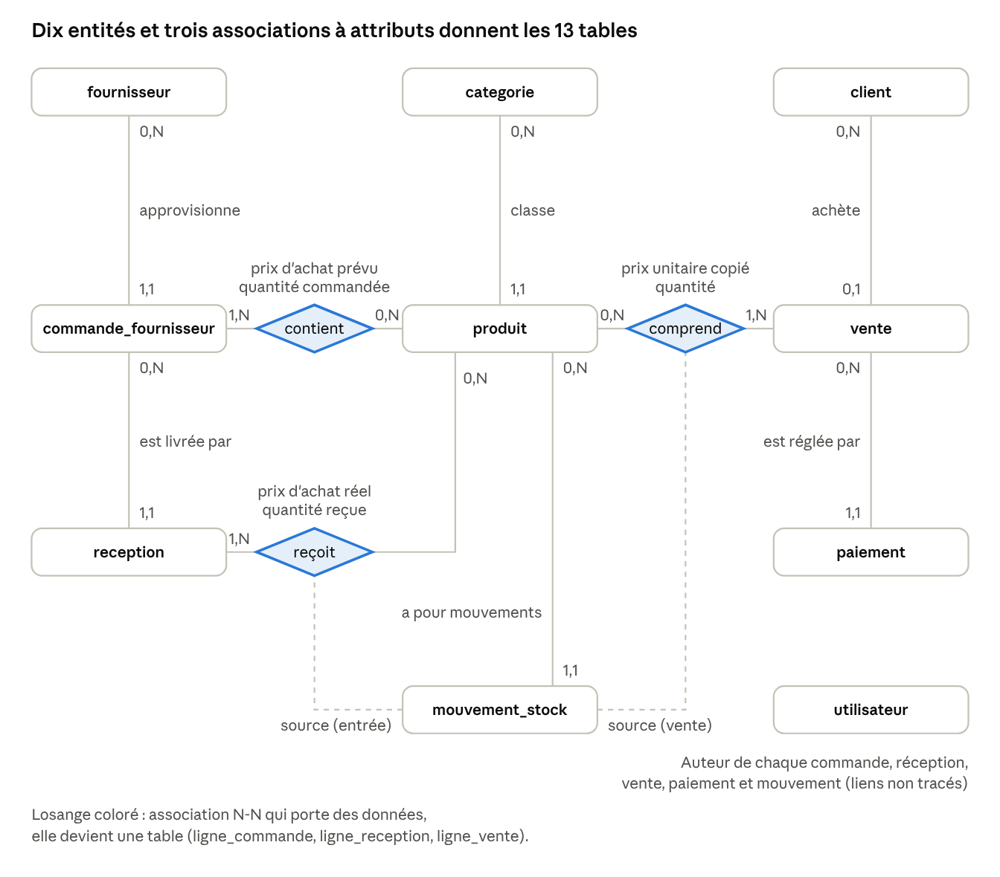
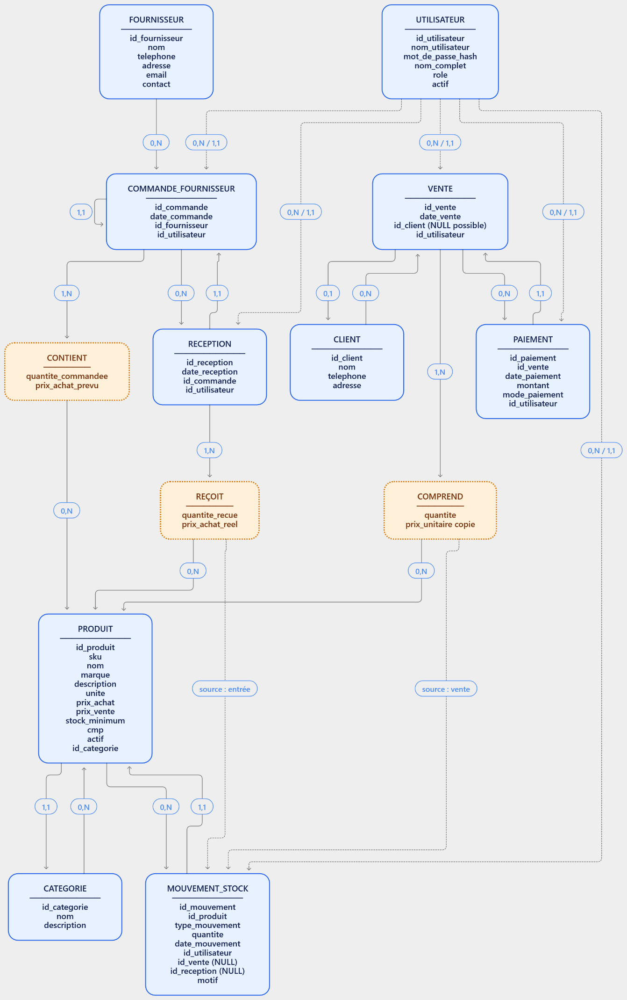
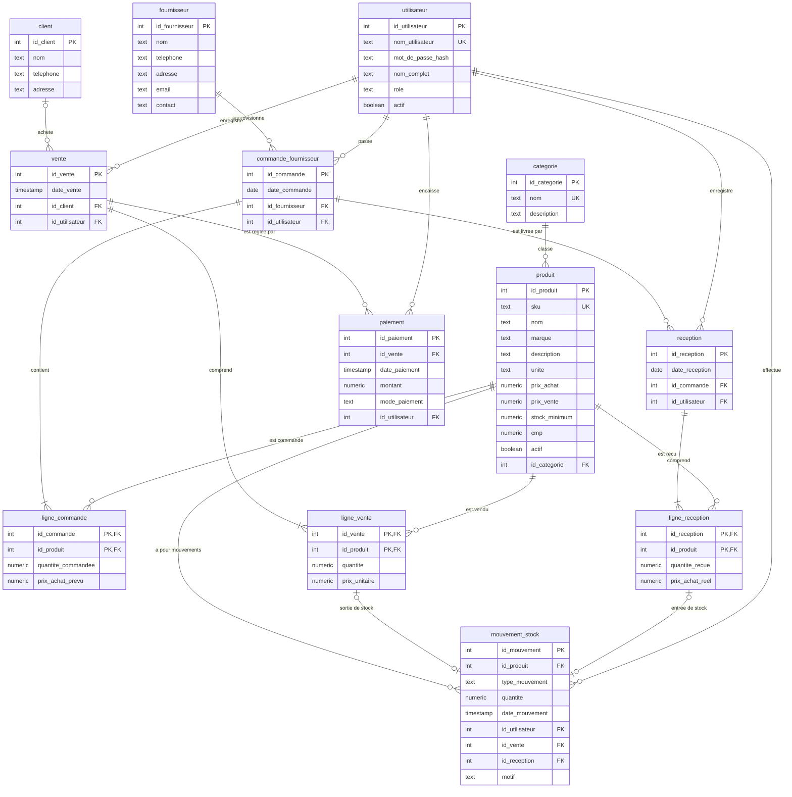

# Dossier de modélisation : GestQuinca

Ce document présente le modèle entité-association, sa transformation en schéma relationnel (clés primaires et étrangères), les dépendances fonctionnelles de chaque relation et la justification de la normalisation jusqu'à la forme normale de Boyce-Codd (BCNF). Il est cohérent avec les scripts `db/01_schema.sql` à `db/03_triggers.sql`.

## 1. Choix de conception

- Nommage en `snake_case`, au singulier, sans accent (`id_produit`, `ligne_vente`).
- Chaque entité a une clé primaire entière auto-générée (`id_xxx`, `GENERATED ALWAYS AS IDENTITY`). Les tables de lignes (`ligne_commande`, `ligne_reception`, `ligne_vente`) ont une clé primaire **composée** `(id_document, id_produit)`.
- Montants en ariary : `NUMERIC(14,2)`. Quantités : `NUMERIC(12,3)` (le kg, le litre et le mètre peuvent être décimaux).
- Toutes les clés étrangères sont en `ON DELETE RESTRICT` : une donnée utilisée n'est jamais supprimée (un produit utilisé est désactivé, `actif = false`).
- **Les valeurs calculables ne sont pas stockées** : stock, total d'une vente, solde, statut de paiement, statut d'une commande, créance d'un client sont calculés par des vues (section 6). Les stocker créerait une redondance et un risque d'incohérence.

### Décisions sur les données dérivées ou copiées

| Donnée | Décision | Justification |
|---|---|---|
| Stock d'un produit | Non stocké : somme des `mouvement_stock.quantite` (vue `v_stock`) | Une seule source de vérité : le journal des mouvements |
| Total, solde, statut d'une vente ou d'une commande | Non stockés : vues | Éviter une dépendance transitive et les incohérences |
| `produit.cmp` (coût moyen pondéré) | **Stocké**, comme cache | Il dépend uniquement de `id_produit` : la BCNF est respectée. Il est recalculé par un trigger à chaque réception (RG05) |
| `ligne_vente.prix_unitaire` | Stocké : copie du prix au moment de la vente (RG07) | Ce n'est pas une redondance de `produit.prix_vente` : c'est une donnée historique qui dépend de `(id_vente, id_produit)` et non de `id_produit` seul |
| Produit d'une réception | Doit figurer dans la commande | Une clé étrangère ne peut pas l'exprimer sans dupliquer `id_commande` dans la ligne (ce qui casserait la 2FN) : c'est donc un trigger (RG03) |
| Ajustement de stock | Mouvement de type `AJUSTEMENT` avec un motif | Pas de table séparée : le journal reste unique |
| Auteur des opérations | Clé étrangère simple vers `utilisateur` | Traçabilité : on sait qui a fait chaque opération |

## 2. Modèle entité-association

Le modèle compte **10 entités** et **3 associations plusieurs-à-plusieurs qui portent des données** (quantités et prix). Les cardinalités sont notées (minimum, maximum) du côté de l'entité concernée. Dans le schéma, un losange coloré est une association qui devient une table.



### Entités

| Entité | Identifiant | Attributs |
|---|---|---|
| `utilisateur` | `id_utilisateur` | nom_utilisateur, mot_de_passe_hash, nom_complet, role, actif |
| `categorie` | `id_categorie` | nom, description |
| `produit` | `id_produit` | sku, nom, marque, description, unite, prix_achat, prix_vente, stock_minimum, cmp, actif |
| `fournisseur` | `id_fournisseur` | nom, telephone, adresse, email, contact |
| `client` | `id_client` | nom, telephone, adresse |
| `commande_fournisseur` | `id_commande` | date_commande |
| `reception` | `id_reception` | date_reception |
| `vente` | `id_vente` | date_vente |
| `paiement` | `id_paiement` | date_paiement, montant, mode_paiement |
| `mouvement_stock` | `id_mouvement` | type_mouvement, quantite, date_mouvement, motif |

### Associations

| Association | Entités liées | Cardinalités | Attributs portés |
|---|---|---|---|
| `classe` | `categorie` — `produit` | catégorie (0,N) ; produit (1,1) | |
| `approvisionne` | `fournisseur` — `commande_fournisseur` | fournisseur (0,N) ; commande (1,1) | |
| `est livrée par` | `commande_fournisseur` — `reception` | commande (0,N) ; réception (1,1) | |
| `achète` | `client` — `vente` | client (0,N) ; vente (0,1) : une vente comptant peut être anonyme | |
| `est réglée par` | `vente` — `paiement` | vente (0,N) ; paiement (1,1) | |
| `a pour mouvements` | `produit` — `mouvement_stock` | produit (0,N) ; mouvement (1,1) | |
| **`contient`** | `commande_fournisseur` — `produit` | commande (1,N) ; produit (0,N) | `quantite_commandee`, `prix_achat_prevu` |
| **`reçoit`** | `reception` — `produit` | réception (1,N) ; produit (0,N) | `quantite_recue`, `prix_achat_reel` |
| **`comprend`** | `vente` — `produit` | vente (1,N) ; produit (0,N) | `quantite`, `prix_unitaire` (copie) |

Les mouvements d'entrée et de vente sont rattachés à la ligne qui les a produits (`reçoit` et `comprend`) : c'est le lien en pointillés du schéma. Chaque commande, réception, vente, paiement et mouvement a aussi un auteur (`utilisateur`, cardinalité (0,N) côté utilisateur et (1,1) côté opération ; ces liens ne sont pas tracés pour ne pas alourdir le schéma).

Version plus détaillée, avec les attributs et les cardinalités de chaque lien :



## 3. Passage du modèle entité-association au schéma relationnel

Règles appliquées :
1. **Entité → table** : l'identifiant devient la clé primaire, les attributs deviennent des colonnes (10 tables).
2. **Association (x,N)–(1,1) → clé étrangère** du côté « 1,1 » (ex. `produit.id_categorie`, `reception.id_commande`). Un lien (0,1) donne une clé étrangère **nullable** (`vente.id_client`).
3. **Association N–N portant des données → table** dont la clé primaire est la **paire** des clés des deux entités, avec les attributs portés comme colonnes : `contient` → `ligne_commande`, `reçoit` → `ligne_reception`, `comprend` → `ligne_vente` (3 tables).
4. **Auteur d'une opération** : clé étrangère `id_utilisateur` dans chaque table concernée.

Total : 10 + 3 = **13 tables**.

## 4. Schéma relationnel

Notation : la **clé primaire** est la première colonne de chaque relation (les deux premières colonnes pour les tables de lignes) ; `#` = clé étrangère ; `UNIQUE` = clé candidate.

```
utilisateur          (id_utilisateur, nom_utilisateur UNIQUE, mot_de_passe_hash, nom_complet, role, actif)
categorie            (id_categorie, nom UNIQUE, description)
produit              (id_produit, sku UNIQUE, nom, marque, description, unite, prix_achat, prix_vente,
                      stock_minimum, cmp, actif, #id_categorie)
fournisseur          (id_fournisseur, nom, telephone, adresse, email, contact)
client               (id_client, nom, telephone, adresse)

commande_fournisseur (id_commande, date_commande, #id_fournisseur, #id_utilisateur)
ligne_commande       (#id_commande, #id_produit, quantite_commandee, prix_achat_prevu)
reception            (id_reception, date_reception, #id_commande, #id_utilisateur)
ligne_reception      (#id_reception, #id_produit, quantite_recue, prix_achat_reel)

vente                (id_vente, date_vente, #id_client (NULL possible), #id_utilisateur)
ligne_vente          (#id_vente, #id_produit, quantite, prix_unitaire)
paiement             (id_paiement, #id_vente, date_paiement, montant, mode_paiement, #id_utilisateur)

mouvement_stock      (id_mouvement, #id_produit, type_mouvement, quantite, date_mouvement, #id_utilisateur,
                      #(id_vente, id_produit) (NULL possible), #(id_reception, id_produit) (NULL possible), motif)
```

Clés primaires : `id_xxx` pour les 10 entités ; `(id_commande, id_produit)`, `(id_reception, id_produit)` et `(id_vente, id_produit)` pour les 3 tables de lignes.

### Clés étrangères

| Table | Clé étrangère | Référence |
|---|---|---|
| `produit` | `id_categorie` | `categorie` |
| `commande_fournisseur` | `id_fournisseur`, `id_utilisateur` | `fournisseur`, `utilisateur` |
| `ligne_commande` | `id_commande`, `id_produit` | `commande_fournisseur`, `produit` |
| `reception` | `id_commande`, `id_utilisateur` | `commande_fournisseur`, `utilisateur` |
| `ligne_reception` | `id_reception`, `id_produit` | `reception`, `produit` |
| `vente` | `id_client` (nullable), `id_utilisateur` | `client`, `utilisateur` |
| `ligne_vente` | `id_vente`, `id_produit` | `vente`, `produit` |
| `paiement` | `id_vente`, `id_utilisateur` | `vente`, `utilisateur` |
| `mouvement_stock` | `id_produit`, `id_utilisateur` | `produit`, `utilisateur` |
| `mouvement_stock` | `(id_vente, id_produit)` | `ligne_vente` (clé composée) |
| `mouvement_stock` | `(id_reception, id_produit)` | `ligne_reception` (clé composée) |

Toutes en `ON DELETE RESTRICT`. Les deux clés étrangères composées de `mouvement_stock` sont ignorées par PostgreSQL quand une de leurs colonnes est `NULL` : un mouvement de vente est donc forcément relié à une ligne de vente existante, un ajustement n'est relié à rien.

### Diagramme du schéma relationnel



## 5. Dépendances fonctionnelles et normalisation (BCNF)

**Rappel.** Une relation est en **BCNF** si, pour chacune de ses dépendances fonctionnelles non triviales `X → Y`, `X` est une **clé** (ou une surclé) de la relation. La BCNF est plus stricte que la 3FN : elle exclut aussi les dépendances dont le déterminant n'est pas une clé, même quand `Y` fait partie d'une clé.

**Méthode.** Pour chaque relation, on liste ses dépendances fonctionnelles d'après les règles de gestion, puis on vérifie que chaque déterminant est une clé.

### 5.1 Les 10 relations à clé simple

Pour chacune, la clé primaire détermine tous les autres attributs. Les clés candidates supplémentaires (`UNIQUE`) déterminent aussi tous les autres attributs, et ce sont bien des clés.

| Relation | Dépendances fonctionnelles | Déterminants | BCNF |
|---|---|---|---|
| `utilisateur` | `id_utilisateur → nom_utilisateur, mot_de_passe_hash, nom_complet, role, actif` ; `nom_utilisateur → id_utilisateur, …` | `id_utilisateur` (clé), `nom_utilisateur` (clé candidate, `UNIQUE`) | ✅ |
| `categorie` | `id_categorie → nom, description` ; `nom → id_categorie, …` | `id_categorie`, `nom` (`UNIQUE`) : deux clés | ✅ |
| `produit` | `id_produit → sku, nom, marque, description, unite, prix_achat, prix_vente, stock_minimum, cmp, actif, id_categorie` ; `sku → id_produit, …` | `id_produit`, `sku` (`UNIQUE`, RG01) : deux clés | ✅ |
| `fournisseur` | `id_fournisseur → nom, telephone, adresse, email, contact` | `id_fournisseur` | ✅ |
| `client` | `id_client → nom, telephone, adresse` | `id_client` | ✅ |
| `commande_fournisseur` | `id_commande → date_commande, id_fournisseur, id_utilisateur` | `id_commande` | ✅ |
| `reception` | `id_reception → date_reception, id_commande, id_utilisateur` | `id_reception` | ✅ |
| `vente` | `id_vente → date_vente, id_client, id_utilisateur` | `id_vente` | ✅ |
| `paiement` | `id_paiement → id_vente, date_paiement, montant, mode_paiement, id_utilisateur` | `id_paiement` | ✅ |
| `mouvement_stock` | `id_mouvement → id_produit, type_mouvement, quantite, date_mouvement, id_utilisateur, id_vente, id_reception, motif` | `id_mouvement` | ✅ (voir 5.3) |

Ce qui est **absent** de ces relations est justement ce qui évite une dépendance qui ne serait pas portée par une clé :
- `vente` ne contient ni le nom ni l'adresse du client, seulement `id_client` : sinon on aurait `id_client → nom_client`, dont le déterminant n'est pas une clé de `vente` (dépendance transitive).
- `produit` ne contient ni le nom de la catégorie ni le stock actuel.
- `vente` ne contient pas son total, `commande_fournisseur` pas son statut : ce sont des vues.

### 5.2 Les 3 relations de lignes (clé composée)

| Relation | Clé | Dépendances fonctionnelles | BCNF |
|---|---|---|---|
| `ligne_commande` | `(id_commande, id_produit)` | `(id_commande, id_produit) → quantite_commandee, prix_achat_prevu` | ✅ |
| `ligne_reception` | `(id_reception, id_produit)` | `(id_reception, id_produit) → quantite_recue, prix_achat_reel` | ✅ |
| `ligne_vente` | `(id_vente, id_produit)` | `(id_vente, id_produit) → quantite, prix_unitaire` | ✅ |

**Pourquoi elles sont aussi en 2FN.** Aucun attribut non clé ne dépend d'une **partie** de la clé :
- `prix_unitaire` ne dépend pas de `id_produit` seul : un même produit est vendu à des prix différents à des dates différentes. S'il en dépendait, ce serait `produit.prix_vente` et la colonne serait redondante. Il dépend bien de la paire `(id_vente, id_produit)` (RG07).
- `prix_achat_reel` et `quantite_recue` dépendent de la paire `(id_reception, id_produit)`, jamais de l'un des deux seuls.
- On n'a **pas** recopié `id_commande` dans `ligne_reception` pour vérifier que le produit reçu figure dans la commande : `id_reception → id_commande` aurait créé une dépendance sur une partie de la clé (violation de la 2FN). Cette règle est donc vérifiée par un trigger, pas par la structure.

### 5.3 Le cas particulier de `mouvement_stock`

- Sa clé est `id_mouvement`, et toutes les dépendances partent de cette clé : la relation est en BCNF.
- Les deux unicités conditionnelles (`ux_mouvement_vente`, `ux_mouvement_reception`) garantissent qu'une ligne de vente ou de réception ne produit **qu'un seul** mouvement. Elles ne créent pas de dépendance fonctionnelle hors clé : les colonnes `id_vente`, `id_reception` et `motif` sont `NULL` selon le type du mouvement (contrainte `CHECK`), ce qui est une règle d'intégrité, pas une dépendance entre attributs.
- `quantite` d'un mouvement de vente vaut `-quantite` de la ligne de vente correspondante. Cette valeur se retrouve donc dans deux relations. Ce n'est pas une violation de la BCNF, qui s'apprécie relation par relation. C'est une redondance **voulue et contrôlée** : le journal des mouvements est la source de vérité du stock (il garde l'historique de ce qui a réellement bougé, y compris les ajustements). La clé étrangère composée vers `ligne_vente` et le trigger de la base empêchent toute incohérence (RG06 et RG11).

### 5.4 Conclusion

Les 13 relations sont en 1FN (valeurs atomiques, clés définies), en 2FN (aucune dépendance sur une partie de clé : les clés composées n'existent que dans les 3 tables de lignes, vérifiées au 5.2), en 3FN (aucune dépendance transitive : aucun attribut non clé n'en détermine un autre) et **en BCNF** : dans chaque relation, tout déterminant est une clé. Aucune décomposition supplémentaire n'est nécessaire.

La seule valeur dérivée stockée, `produit.cmp`, ne dépend que de la clé `id_produit` : elle ne brise pas la BCNF. C'est un cache de performance, recalculé par trigger à chaque réception.

## 6. Données calculées : les vues

| Vue | Rôle | Calcul |
|---|---|---|
| `v_stock` | stock actuel de chaque produit | somme de `mouvement_stock.quantite` ; indique si le produit est sous le seuil |
| `v_total_vente` | total d'une vente | somme de `quantite × prix_unitaire` sur ses lignes |
| `v_solde_vente` | total payé, solde et statut de paiement (`non_payee`, `partiellement_payee`, `payee`) | total de la vente moins somme des paiements |
| `v_statut_commande` | statut d'une commande (`en_cours`, `partiellement_recue`, `recue`) | quantités reçues comparées aux quantités commandées |
| `v_creance_client` | ce que chaque client doit encore | somme des soldes de ses ventes |

## 7. Contraintes d'intégrité

L'intégrité est garantie **par la base de données** et non par l'interface : le code de l'API ne fait que transmettre les erreurs.

| Type | Mécanisme | Exemples |
|---|---|---|
| Clés primaires et étrangères | `PRIMARY KEY`, `REFERENCES … ON DELETE RESTRICT` | impossible de supprimer un client qui a des ventes |
| Unicité | `UNIQUE`, index uniques partiels | `produit.sku` (RG01), un mouvement par ligne de vente |
| Valeurs valides | `CHECK`, `NOT NULL` | quantités > 0, montants ≥ 0, rôle `admin`/`vendeur`, unités autorisées |
| Règles métier | triggers PL/pgSQL | quantité reçue ≤ quantité commandée (RG03), stock jamais négatif avec verrou de ligne (RG06), paiement ≤ solde (RG08), vente à crédit sans client refusée (RG10), historique des mouvements immuable (RG11) |

La liste complète des règles de gestion RG01 à RG14 est dans le `README.md`.
